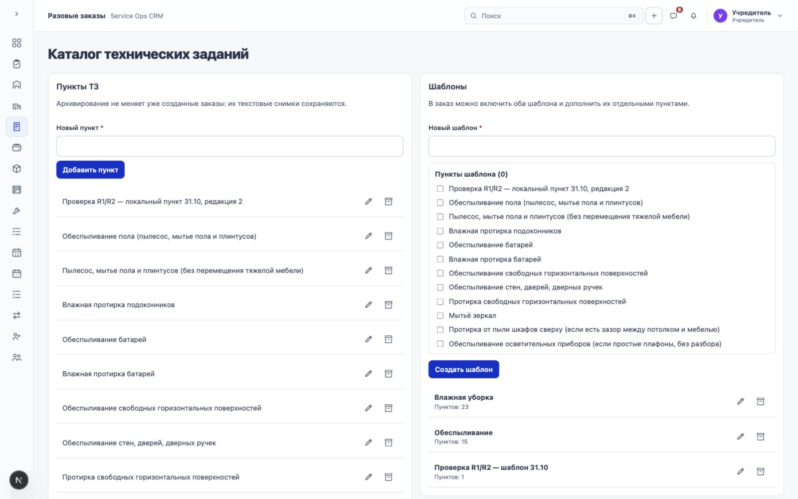
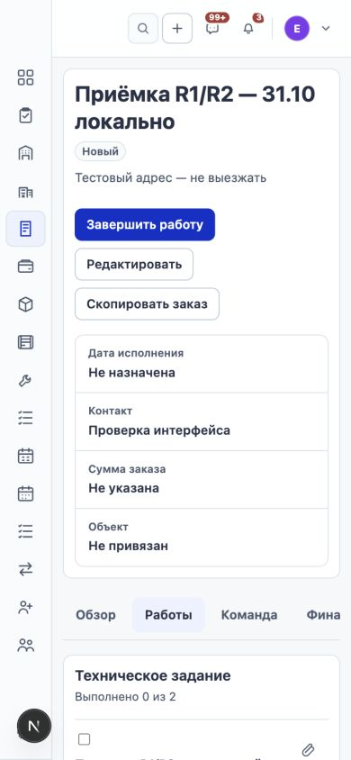

# Локальная приёмка R1 и R2 — 31 октября 2026

## Результат и границы

R1 (каталог/шаблоны/снимок ТЗ) и R2 (исполнение, комментарии, необязательные вложения и аудит) реализованы и приняты локально в пределах перечисленных ниже проверок. Это не приёмка всей CRM (R0) и не production-релиз. Сервер, DNS, production-БД и рабочие данные сервера не изменялись. Коммит и push в этом проходе не выполнялись.

Локальный тестовый заказ, созданный через интерфейс: `/one-time-orders/19e02498-93a0-4fbb-bd77-109ad85ad88c?section=execution`, название «Приёмка R1/R2 — 31.10 локально». Созданы также явно помеченные тестовые пункт и шаблон. Они оставлены для повторной проверки. Исторические пользовательские записи не переписывались.

## Что исправлено

- Каталог: названия и действия выровнены сеткой; карандаш и архив используют существующие иконки, IconButton, Tooltip и ConfirmDialog. Названия доступны скринридеру; фокус переводится в поле редактирования. Архивирование/восстановление объясняет сохранность прежних заказов.
- Колонки каталога больше не получают лишний legacy-отступ соседних Surface. Названия переносятся, действия не распадаются на вертикальные группы, подсказки у правого края остаются внутри экрана.
- Шапка заказа переносит действия при нехватке ширины; flex-basis применяется только в горизонтальной раскладке, чтобы не создавать пустоту на мобильном экране.
- Создание заказа явно требует плановый способ оплаты; пропуск даёт конкретное сообщение и фокус на соответствующем поле.
- Каталог в диалоге перечитывается при каждом открытии. Устаревшая версия не применяется; после конфликта показывается актуальный состав.
- Неопределённая отправка применения каталога сохраняет исходный payload/requestId при закрытии диалога. Повтор разрешает исходный запрос, а изменение состава блокируется до результата.
- Комментарии: отдельные черновики/loading/error/pending для каждого пункта; merge по ID, защита от поздних ответов и повторного submit. Повторяется исходный POST, совпадение текста не используется как доказательство успеха. Позднее сохранение одного пункта не очищает другой черновик.
- Ошибка частичной загрузки перечисляет неудачные файлы; при ответе 413 указывается лимит 25 МБ. Успешные вложения сохраняются; повтор касается только неудачных.
- История пунктов отделяет контекст события от изменения полей: отвязка файла не изображается как удаление самого пункта, название пункта не называется названием заказа.
- Устаревший тест R1 теперь отмечает выполнение назначенным менеджером и отдельно проверяет отказ руководителю без назначения. Тесты R2 используют реальный upload/storage, а не только Prisma fixture.

## Автоматические доказательства

| Проверка | Результат |
| --- | --- |
| `one-time-order-specification-catalog.integration.test.ts` | 1 тест: руководство/менеджер, два шаблона и отдельные пункты, сохранность снимка, архив, устаревшие версии, параллельные повторы создания и применения |
| `one-time-order-specification.integration.test.ts` | 2 теста: lifecycle пунктов, комментарии и конкурентный retry, scoped access, закрытый заказ/снятое назначение, multipart upload/view/content/retry, mixed batch 201/413, detach без удаления File, 401 и запрет подстановки employeeId/createdByUserId |
| `file-upload.integration.test.ts` | 1 тест: реальный upload и чтение через backend proxy |
| `media-batch-retry.integration.test.ts` | 1 тест: регрессия пакетной загрузки и повтора на общих файловых сценариях |
| Backend/frontend typecheck и lint | Пройдены |
| CSS audit | 79 файлов; нет отсутствующих/неиспользуемых классов или неопределённых UI-токенов |
| Backend build и Next production build | Пройдены; 38 статических страниц сгенерированы |
| `git diff --check` | Пройден |

Итого: 5 целевых интеграционных тестов в четырёх изолированных схемах. Тесты запускались с Mac; основная локальная схема не использовалась как тестовая. Это целевой набор, а не полный прогон всех тестов CRM. Предупреждение Next о необнаруженном ESLint-плагине остаётся неблокирующим; ошибок сборки нет.

## Ручной проход через интерфейс

Руководитель: создание каталожного пункта → создание шаблона из него → создание заказа с шаблоном и назначенной Елисеевой → изменение исходного каталожного текста → проверка прежнего текста в заказе → добавление новой редакции к существующему ТЗ без замены старого пункта. Проверены карандаш/фокус, отмена подтверждения, архив и восстановление тестового пункта; отдельно проверены изменение названия, архив и восстановление тестового шаблона.

Назначенный менеджер: доступ к тому же заказу; отсутствие действий изменения состава/текста ТЗ; выполнение без фото; повторное открытие; обычный и длинный комментарий; сохранение отдельных черновиков при переключении пунктов, в том числе пока другой комментарий отправляется; автор/дата; сохранность комментариев после перезагрузки.

Вложения: реальная загрузка TXT и PNG, просмотр TXT в файловом просмотрщике, скачивание через браузер, отвязка ошибочного тестового файла с явным подтверждением. Смешанный пакет PNG + TXT 26 МБ: PNG сохранился, большой файл отклонён, ошибка видима. Вложения остались после перезагрузки. В истории видны выполнение, повторное открытие, комментарии, добавление и отвязка файлов с автором/временем.

Обычный неизвестный тип файла сохраняется по существующей политике как `application/octet-stream` и не получает небезопасного inline-preview. В этом проходе не вводился новый запрет расширений.

## Визуальная и клавиатурная проверка

- Каталог и заказ проверены на узком и широком экране; контрольные размеры 390/768/1280/1600 px. Отдельно проверен нативный Safari 200%.
- Проверены длинные названия, перенос действий, отсутствие горизонтального переполнения документа на измеренных ширинах заказа; горизонтальный скролл вкладок остаётся предусмотренной навигацией.
- Меню «⋯» открывается с клавиатурным фокусом; Escape возвращает его на триггер. Использованы прежние подтверждения/поля и текущие цветовые токены.
- Настоящий zoom 200% выбран в меню Safari (показано значение «200 %»), а не имитирован CSS. Каталог и шапка заказа не перекрывают действия. После проверки масштаб возвращён к обычному, отдельное тестовое окно закрыто.
- Выполнен целевой проход по актуальным Vercel Web Interface Guidelines; правила проекта остаются приоритетными.

## Что не выдаётся за выполненное

- Потеря уже принятого сервером ответа и параллельная запись проверяются интеграционными тестами и целевым ревью; искусственный обрыв именно после commit в живом браузере не воспроизводился.
- Сохранение pending-запроса/черновика после полного закрытия браузера или перезагрузки страницы не заявляется. Подтверждено повторное открытие диалога на текущей странице и сохранность уже записанных данных после reload.
- Запрос доступа/съёмка настоящей камерой устройства не запускались; проверен файловый путь существующего меню.
- Это не сквозной R0, не security-аудит всей системы и не проверка production после выкладки. Общие проверки других экранов/ролей и финальная регрессия всей CRM остаются в R0.

## Локальная среда

При диагностике найдены OOM-событие Docker и устаревший Prisma Client в контейнере. Клиент перегенерирован, все 103 миграции применены. API локально работает из актуальной сборки без тяжёлого watch-компилятора, через временный override `/private/tmp/service-ops-crm-runtime-check.yml`; после правок backend нужна сборка и перезапуск. Обычная команда dev Compose может вернуть watch-режим. Значения памяти Docker и другие проекты не изменялись.

Контрольные скриншоты сохраняются в `docs/verification/r1-r2-2026-10-31/`.

## Контрольные снимки

Каталог, 1600 px:

Заказ под назначенным менеджером, 390 px:

Дополнительно: [каталог при 200% Safari](verification/r1-r2-2026-10-31/catalog-safari-200-percent.png), [заказ при 200% Safari](verification/r1-r2-2026-10-31/order-safari-200-percent.png), [заказ 768 px](verification/r1-r2-2026-10-31/order-manager-768.png), [заказ 1600 px](verification/r1-r2-2026-10-31/order-manager-1600.png).
